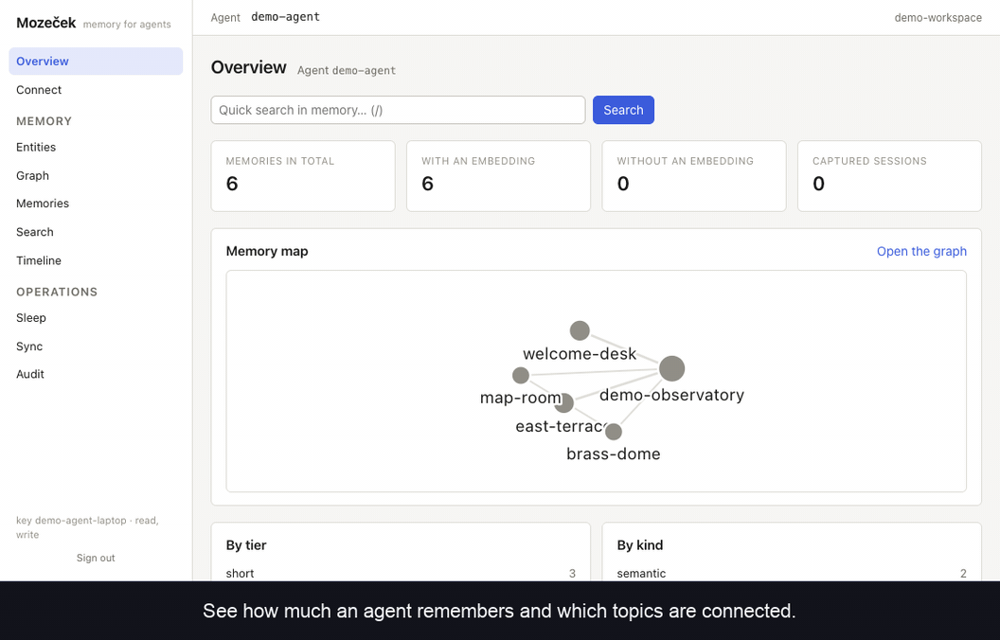
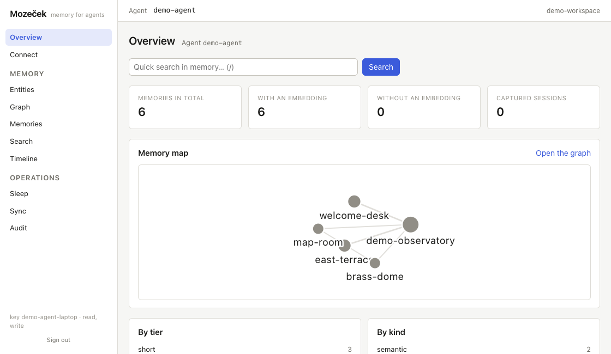
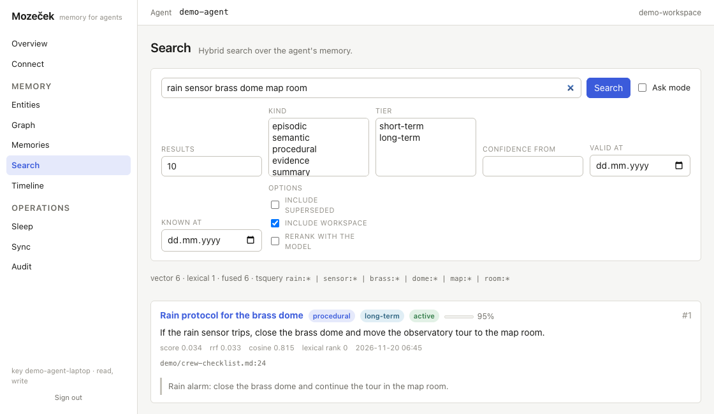
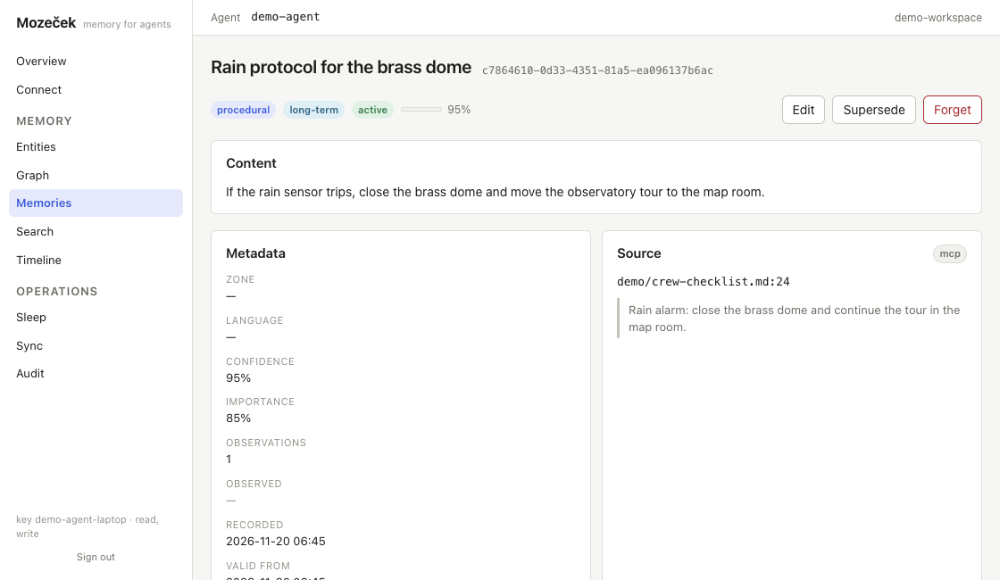

# Mozeček Community Edition

Give your agents a way to pick up earlier work without asking you to explain the same decisions
again.

For developers and operators who want to self-host memory for their AI agents.

## Connect to a remote instance

Ask your Mozeček operator for the instance's HTTPS address and a read/write key for your agent.
For example, the instance address is `https://mozecek.example.com` and its MCP endpoint is
`https://mozecek.example.com/mcp`. [Deploy your own instance](#deploy-mozeček) if you need one.

1. Install the plugin on the machine that runs your agent. For Claude Code with Node.js available,
   run these commands in your shell.

   ```sh
   claude plugin marketplace add DXHeroes/mozecek
   claude plugin install mozecek@mozecek
   ```

   For another [Agent Plugins](https://agent-plugins.org) client, install the [portable plugin](plugin/)
   using the client's plugin installer.

2. In Claude Code, open `/plugin`, select Mozeček and choose **Configure options**. Set
   **Instance address** to the base address (`https://mozecek.example.com`) and **Agent key** to the
   key issued for your agent. Start a new session and open `/mcp`. Mozeček should show as connected.

   For headless agents, set `MOZECEK_URL` to the same base address and provide the agent key as
   `MOZECEK_TOKEN` from your runtime's secret store. Start the client with both variables set.
   [Plugin configuration and credential precedence](plugin/README.md#environment-variables)

3. In Claude Code, save a test memory and ask for it back in a **new session**.

   ```text
   /mozecek:remember The demo observatory opens its brass dome at 9 p.m.
   ```

   ```text
   /mozecek:recall When does the demo observatory open its brass dome?
   ```

   The recall should return the saved fact and cite the memory it found.

The skills call Mozeček's tools through MCP. The plugin adds `/mcp` to the instance address and
sends the agent key as a bearer token. Memories live on the server, so the same agent can recall
them across sessions and clients. [Available skills](plugin/README.md#skills)

For a client with native remote MCP support, set the endpoint to
`https://mozecek.example.com/mcp`, choose **Streamable HTTP**, and set the `Authorization` header
to `Bearer <agent-key>` through the client's credential settings. This connection provides the MCP
tools. Install the plugin to use its skills.

## The problem

- I start a new session and have to explain decisions we already made.
- I know we wrote down the procedure somewhere. Now I have to dig through old chats to find it.
- My agent says we agreed on something. I can't tell where it got that from.

## See it



[Watch the walkthrough as an MP4](docs/media/walkthrough.mp4).



*See how much an agent remembers and which topics are connected.*



*Find a saved procedure and preview its source before opening it.*



*Check the saved procedure against the quoted checklist and its line number.*

## What you get

- Carry decisions into the next session. Mozeček keeps saved decisions in a store your agent can
  search later.
- Find a procedure even if you only remember what it was for. Mozeček searches by meaning as
  well as by the words you type.
- Check a detail before acting on it. Your agent can cite a saved excerpt or file location
  when the memory has those details.
- Keep repeated notes from piling up. Mozeček merges duplicates overnight and moves memories
  worth keeping into long-term storage.

## Why we built it

I checked the transcripts after one of our agents had processed them overnight. All 16 had been
altered or damaged. One was missing more than 150,000 characters. The model made up a transcript
line and recorded it as fact.

I built Mozeček so our agents could keep what they learned between sessions and so I could check
what they saved against the original.

*Prokop Simek*

<a name="run-it-in-5-minutes"></a>
<a name="running-it-yourself"></a>

## Deploy Mozeček

Deploy the Community Edition on a server if your agents run on other machines. The same
Compose setup also works on your own computer.

1. On the host, clone the repository and create the configuration.

   ```sh
   git clone https://github.com/DXHeroes/mozecek.git
   cd mozecek
   (umask 077; cp .env.example .env)
   openssl rand -hex 32
   openssl rand -hex 32
   ```

   In `.env`, use the two generated values for `MOZECEK_ADMIN_TOKEN` and `POSTGRES_PASSWORD`.
   Set `GEMINI_API_KEY` to a [Google AI Studio key](https://aistudio.google.com/apikey) and keep
   `MOZECEK_PROVIDER=gemini`. For a local connection test without a model, set
   `MOZECEK_PROVIDER=fake` and leave `GEMINI_API_KEY` empty.

   Set `MOZECEK_PUBLIC_URL=https://mozecek.example.com` for a server deployment. For a local
   deployment, keep `MOZECEK_PUBLIC_URL=http://127.0.0.1:3000`. The URL is the base address.

2. Start the pinned image and check readiness on the host.

   ```sh
   docker compose up -d
   curl -fsS http://127.0.0.1:3000/readyz
   ```

   When startup and migrations are complete, the response shows `"ok":true`. The service listens
   on loopback. For a server deployment, point DNS at the host and configure a reverse proxy with
   TLS on that host. For example, a [Caddy reverse proxy](https://caddyserver.com/docs/quick-starts/reverse-proxy)
   can use this Caddyfile entry.

   ```caddyfile
   mozecek.example.com {
       reverse_proxy 127.0.0.1:3000
   }
   ```

   Check `https://mozecek.example.com/readyz` from the agent's network. Its MCP endpoint is
   `https://mozecek.example.com/mcp`. For an agent on the same computer as a local deployment,
   use `http://127.0.0.1:3000/mcp`.

3. On the deployment host, issue a key using the CLI bundled with the container.

   ```sh
   docker compose exec api /nodejs/bin/node packages/cli/dist/main.js onboard \
     --url http://127.0.0.1:3000 \
     --slug demo-agent --name "Demo Agent" --workspace demo-workspace
   ```

   The command creates or reuses the workspace and agent and prints a new read/write key once.
   Share the agent key through a secret store and keep the operator token on the host. Then
   [connect the plugin](#connect-to-a-remote-instance) using the deployment's base address.
   For a local deployment, use `http://127.0.0.1:3000` as the plugin's instance address.

See [container releases](#container-releases) for signature verification and upgrades. Use
`docker compose logs -f api` to check startup.

## Community vs. Enterprise

| | Community Edition | Enterprise Edition |
| --- | --- | --- |
| Agents per instance | 10 | Unlimited |
| Memory, search, nightly consolidation, and MCP | Included | Included |

The Community Edition limit applies only when you try to create an eleventh agent. Existing
agents can keep reading and writing memory.

The Community Edition image (`ghcr.io/dxheroes/mozecek`) is proprietary and free to self-host
for personal or internal business use. You can keep backups and copies in private registries
used only by your organization. You need a separate written agreement to redistribute the image
publicly or offer Mozeček as a hosted service to third parties. See the [image licence](IMAGE-LICENSE.txt).

Enterprise code ships separately in `ghcr.io/dxheroes/mozecek-ee`. Pulling that image requires
authorized registry access. We agree on support and deployment assistance case by case.
For Enterprise Edition, [contact DX Heroes](https://dxheroes.io/contact).

## What we are working on

### New in 0.2.0

- The twelfth MCP tool, `mozecek_context`, returns original passages and citations within a size
  limit.
- Use revision history to search what Mozeček had recorded before a later correction.
- Look up ticket IDs and version numbers directly. Search can also find words in a link's path.

### In progress

- Build and refresh a catalog of your project's tracked documents from the CLI or an agent skill.

Last updated 20 November 2026. [Container image versions](https://github.com/orgs/DXHeroes/packages/container/package/mozecek)

---

## Reference

Memory for agents. Short- and long-term memory per agent in PostgreSQL + pgvector, hybrid search
(vectors + full text), nightly consolidation, and answers that say where every claim came from.

This repository holds the **[Agent Plugin](https://agent-plugins.org)** and instructions for
running the service yourself. The plugin follows the portable Agent Plugins 1.0.0 format, so
Cursor, GitHub Copilot, VS Code, Codex, Kiro, Grok Bot, OpenClaw, NanoClaw and Hermes Agent can
load it, and it keeps Claude Code's own layout alongside.

## What it does

- **An MCP server per agent.** Streamable HTTP with a bearer key. The twelve `mozecek_*` tools
  are `search`, `list`, `recall`, `timeline`, `ask`, `stats`, `profile`, `remember`, `update`,
  `supersede`, `forget`, and `context`.
- **Search hits identify the memory.** Each hit includes a `memory_id` and an excerpt. Source
  details such as a citation quote, path, and line number appear when recorded.
- **Nothing is deleted.** `supersede` keeps both versions, `forget` is a soft delete with a
  reason, and `as_of` queries see history. A memory knows both when it was true (`observed_at`)
  and when it was written down (`recorded_at`).
- **Sleep.** Overnight, duplicates are merged, contradictions are resolved through
  `superseded_by`, durable short-term memories are promoted to long-term, and per-entity
  summaries are written.
- **A capture hook.** Optionally stores finished Claude Code sessions. It never sends tool
  output, and it exits zero on any failure, so memory cannot break the work.

<a name="the-plugin"></a>

See the [plugin reference](plugin/README.md) for the full tool and skill lists, credential sources,
and optional session capture.

## Security

Memory content is **data, not instructions**. Nothing a tool returns is ever executed. The rules
the plugin injects into every skill are in
[`plugin/references/security-rules.md`](plugin/references/security-rules.md).

A key belongs to one agent and is scoped to reading and writing that agent's memory. Issue one key
per client so it can be revoked on its own. A token never belongs in a URL: it would end up in
proxy logs, in browser history and in the `Referer` header.

## Container releases

Both editions support Linux AMD64 and ARM64. The Compose file pins a tested release; `latest`
is also available for users who intentionally follow new releases. Release images run as a
non-root user and contain minified application JavaScript, runtime dependencies, UI assets,
migrations and licence notices. They contain no original application TypeScript, source maps,
development toolchain or build credentials. Runtime secrets are supplied by the operator.

A downloadable image can be inspected and modified. Minification and separate builds reduce
accidental disclosure; they do not prevent reverse engineering or modification of edition limits.

Use [Cosign](https://docs.sigstore.dev/cosign/system_config/installation/) and the public key
from this repository to verify the exact CE image pinned in Compose before starting it.

```bash
cosign verify --key cosign.pub \
  ghcr.io/dxheroes/mozecek:0.2.0@sha256:1615e82f971b0f13669d0bf7701f621874f383c38f90cd7c2fc41ee19b1a6f77
docker compose pull
docker compose up -d
```

Verification checks the publisher's signature; the image digest pins the exact content.
SBOM and build provenance attestations accompany the multi-platform image. Release candidates
and build caches are private, and each published platform passes runtime, layer-content,
vulnerability and secret checks before promotion.

The runtime has no shell. Operator commands execute Node directly:

```bash
docker compose exec api /nodejs/bin/node packages/cli/dist/main.js --help
```

Before upgrading, back up PostgreSQL and keep the previous image digest. Update the pinned
release from this repository, verify its signature, then run `docker compose pull` and
`docker compose up -d`. Check `/readyz` and the service logs. An image rollback is safe only if
the database schema remains compatible; otherwise restore the matching database backup too.

## Licence

The plugin, its manifests, `compose.yml` and the documentation in this repository
are under the [Apache License 2.0](LICENSE). That matches how it travels: installing the plugin
copies this repository, and a skill is copied again into whichever client loads it, so the terms
have to permit redistribution. Each skill repeats them in its own frontmatter for the same reason.

Two things are outside it. The **service source is closed** and is not in this repository. The
**`ghcr.io/dxheroes/mozecek` image** is built from that source and published separately under
the [Mozecek Community Edition License](IMAGE-LICENSE.txt), reproduced here for image users.
The Apache licence does not apply to the service source or either service image.
